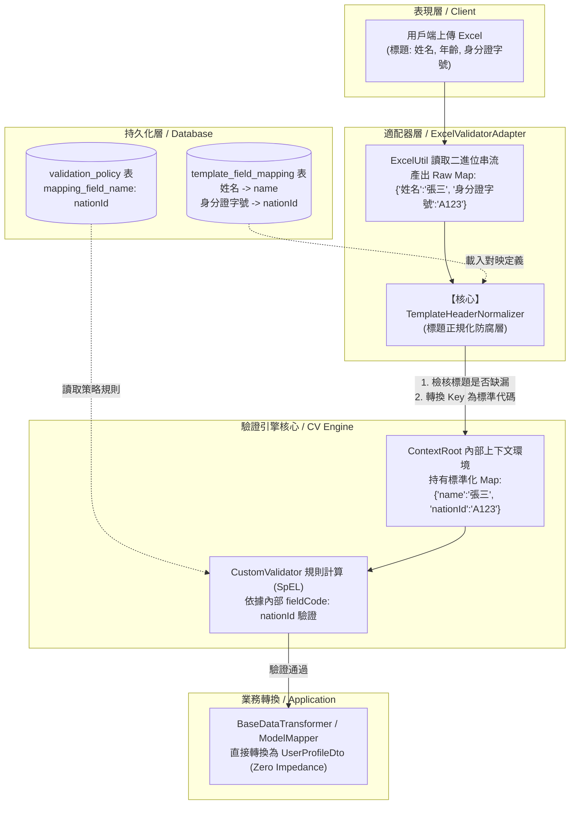

# Excel 範本欄位客製對映機制設計文件 (Template Field Mapping Design Specification)

> **版本**：v1.0.0  
> **狀態**：審查中 (In Review)  
> **架構規範遵循**：[AGENTS.md](file:///d:/桌面/ModuleWorkSpace/customized-validation-module/.agents/AGENTS.md) (Clean Architecture / 六角形架構 / DDD)

---

## 一、 背景與設計目標 (Background & Objectives)

### 1.1 現況痛點分析 (Pain Points)
在現行驗證架構中，Excel 資料讀取與客製驗證機制存在以下強耦合限制：
1. **Excel 標題強制綁定技術代碼**：
   - 目前 `ExcelUtil.readExcelData(...)` 直接擷取 Excel 第 0 列（Header Row）原始字串作為記憶體資料 `Map<String, String>` 的 Key。
   - `ValidationPolicy.mapping_field_name` 被迫必須完全等於 Excel 標題文字（例如 `NAME`, `AGE`, `SEX`, `NATION_ID`）。
   - 導致終端業務人員或客戶無法在 Excel 中填寫語意直觀的中文名稱（如「姓名」、「年齡」、「性別」、「身分證字號」），嚴重降低模組的實用性與通用性。
2. **缺乏標題前置防呆檢核**：
   - 若使用者在 Excel 標題不小心打錯字（例如將 `NATION_ID` 打成 `NATIONAL_ID` 或 `身分證`），系統只會視為找不到該欄位並以空值處理，無法在第一時間告知使用者「缺少必要標題欄位」。
3. **內部 DTO 轉換阻抗 (Impedance Mismatch)**：
   - 後續透過 `BaseDataTransformer` 轉換為 Java Bean / DTO 時，Java 屬性慣例為 CamelCase（如 `nationId`），而 Map 的 Key 卻是大寫蛇形（`NATION_ID`），導致 ModelMapper 無法直接自動對齊，需寫大量自訂轉換邏輯。

### 1.2 設計目標 (Design Objectives)
- **支援任意客製標題**：允許 Excel 欄位自由命名（繁中、英文、簡記均可），不再受限於技術代碼。
- **內部屬性標準化 (Normalization)**：無論 Excel 外部標題為何，讀入後一律正規化為內部統一的 CamelCase 屬性名稱（如 `nationId`）。
- **標題結構前置防呆校驗**：在執行資料列內容驗證前，先核對 Excel 標題結構是否符合範本定義（包含必要欄位是否缺失）。
- **零框架侵入與維持架構純潔性**：遵循六角形架構，將映射定義作為基礎設施持久化實體，對外提供乾淨純粹的標準防腐轉換服務。

---

## 二、 架構全景與資料流 (Architecture Overview & Data Flow)

### 2.1 架構定位 (Hexagonal Architecture Alignment)
- **基礎設施層持久化 (Infrastructure Persistence)**：
  - `com.example.demo.infra.persistence.entity.TemplateFieldMapping`：欄位對映定義實體。
  - `com.example.demo.infra.persistence.repository.TemplateFieldMappingRepository`：Spring Data JPA 倉儲。
- **基礎設施層客製驗證核心 (Infrastructure CV Engine)**：
  - `com.example.demo.infra.cv.normalizer.TemplateHeaderNormalizer`：標題正規化與防腐轉換器。
- **基礎設施適配器 (Infrastructure Outbound Adapter)**：
  - `com.example.demo.infra.adapter.ExcelValidatorAdapter`：在讀取 Excel 後先經由 Normalizer 轉換，再進入 `CustomValidator`。

### 2.2 端到端資料流動圖 (End-to-End Data Flow)



---

## 三、 資料庫與實體設計 (Database Schema & Entity Design)

### 3.1 資料庫 Schema 規格 (`template_field_mapping`)

```sql
CREATE TABLE template_field_mapping (
    id                   BIGINT AUTO_INCREMENT PRIMARY KEY COMMENT '主鍵識別碼',
    template_name        VARCHAR(64)  NOT NULL COMMENT '範本唯一名稱 (例如: USER_PROFILE, DEPT_PROFILE)',
    template_sheet_name  VARCHAR(64)  NOT NULL COMMENT '工作表名稱 (例如: USER, DEPT)',
    field_code           VARCHAR(64)  NOT NULL COMMENT '內部統一屬性代碼 (CamelCase, 例如: name, age, nationId)',
    display_name         VARCHAR(128) NOT NULL COMMENT 'Excel 實體標題文字 (例如: 姓名, 年齡, 身分證字號)',
    column_index         INT          NULL     COMMENT '實體欄位順序 (1-based, 可選)，用於順序嚴格模式',
    is_required          CHAR(1)      NOT NULL DEFAULT 'N' COMMENT '是否為必填/必備欄位 (Y/N)，採用 YesNo 列舉',
    data_type            VARCHAR(32)  NOT NULL DEFAULT 'STRING' COMMENT '資料型別 (STRING, NUMBER, DATE...)',
    active_flag          CHAR(1)      NOT NULL DEFAULT 'Y' COMMENT '啟用註記 (Y/N)，採用 YesNo 列舉',
    created_time         DATETIME     NOT NULL DEFAULT CURRENT_TIMESTAMP COMMENT '建立時間',
    updated_time         DATETIME     NOT NULL DEFAULT CURRENT_TIMESTAMP ON UPDATE CURRENT_TIMESTAMP COMMENT '更新時間',
    
    -- 索引與約束
    CONSTRAINT uq_template_sheet_field UNIQUE (template_name, template_sheet_name, field_code),
    INDEX idx_template_sheet (template_name, template_sheet_name),
    INDEX idx_template_sheet_display (template_name, template_sheet_name, display_name)
) ENGINE=InnoDB DEFAULT CHARSET=utf8mb4 COLLATE=utf8mb4_unicode_ci COMMENT='Excel 範本欄位客製對映定義表';
```

### 3.2 實體類別結構建議 (`TemplateFieldMapping.java`)

```java
package com.example.demo.infra.persistence.entity;

import com.example.demo.application.shared.vo.YesNo;
import jakarta.persistence.*;
import lombok.Getter;
import lombok.Setter;
import lombok.NoArgsConstructor;
import java.io.Serializable;
import java.time.LocalDateTime;

/**
 * 範本欄位客製對映實體 (Template Field Mapping Entity)
 * <p>
 * 位於基礎設施持久化實體層 (Infrastructure Persistence Entity)。
 * 定義外部 Excel 標題顯示文字 (displayName) 與內部標準屬性代碼 (fieldCode) 之映射合約。
 * </p>
 */
@Entity
@Table(name = "template_field_mapping")
@Getter
@Setter
@NoArgsConstructor
public class TemplateFieldMapping implements Serializable {

    private static final long serialVersionUID = 1L;

    @Id
    @GeneratedValue(strategy = GenerationType.IDENTITY)
    private Long id;

    @Column(name = "template_name", nullable = false, length = 64)
    private String templateName;

    @Column(name = "template_sheet_name", nullable = false, length = 64)
    private String templateSheetName;

    @Column(name = "field_code", nullable = false, length = 64)
    private String fieldCode;

    @Column(name = "display_name", nullable = false, length = 128)
    private String displayName;

    @Column(name = "column_index")
    private Integer columnIndex;

    @Enumerated(EnumType.STRING)
    @Column(name = "is_required", nullable = false, length = 1)
    private YesNo isRequired = YesNo.N;

    @Column(name = "data_type", nullable = false, length = 32)
    private String dataType = "STRING";

    @Enumerated(EnumType.STRING)
    @Column(name = "active_flag", nullable = false, length = 1)
    private YesNo activeFlag = YesNo.Y;

    @Column(name = "created_time", nullable = false, updatable = false)
    private LocalDateTime createdTime = LocalDateTime.now();

    @Column(name = "updated_time", nullable = false)
    private LocalDateTime updatedTime = LocalDateTime.now();
}
```

---

## 四、 核心處理機制與演算法 (Core Mechanisms)

### 4.1 標題正規化防腐器 (`TemplateHeaderNormalizer`)
當 `ExcelUtil` 讀取出原始工作表資料 `Map<String, String>`（Key 為實體標題）時，由 `TemplateHeaderNormalizer` 負責：
1. **標題清洗與比對 (Sanitization & Matching)**：
   - 去除 Excel 儲存格首尾空白（`trim()`）。
   - 透過快取或資料庫查詢對映表，建立 `Map<DisplayName, FieldCode>`。
2. **前置標題防呆校驗 (Header Verification)**：
   - 遍歷所有定義為 `isRequired == YesNo.Y` 之欄位，確認是否存在於 Excel 第一列標題中。
   - 若缺失必要標題，直接組裝 [ValidationError](file:///d:/桌面/ModuleWorkSpace/customized-validation-module/src/main/java/com/example/demo/application/shared/vo/ValidationError.java)：
     ```text
     "SheetName : USER, 缺少必要欄位標題：【身分證字號】"
     ```
   - 立即拋出 [ExcelValidationException](file:///d:/桌面/ModuleWorkSpace/customized-validation-module/src/main/java/com/example/demo/application/exception/ExcelValidationException.java)，中止無意義的後續內容計算。
3. **鍵值標準化替換 (Key Normalization)**：
   - 將資料列中的每筆鍵值由原始 `displayName` 替換為 `fieldCode`。
   - 產出新的標準資料列集合傳遞給 `ContextRoot`。

### 4.2 雙向對照能力 (Bidirectional Mapping)
- **讀取方向 (Inbound)**：`Excel 標題（如：身分證字號）` $\rightarrow$ `內部代碼（如：nationId）`。
- **錯誤提示方向 (Outbound)**：當 SpEL 檢核規則在 `nationId` 發生錯誤時，可反查回 `身分證字號`，產出更具親和力的錯誤訊息：
  ```text
  "SheetName : USER, D2 欄位【身分證字號】格式不符規定"
  ```
  而非工程師代碼：
  ```text
  "SheetName : USER, D2 欄位【NATION_ID】格式不符規定"
  ```

---

## 五、 與現有元件整合影響矩陣 (Component Impact Matrix)

| 元件名稱 | 原運作模式 | 整合後運作模式 | 影響程度 |
| :--- | :--- | :--- | :---: |
| `ExcelUtil` | 讀取 Excel 產生 Raw Map (Key: Excel 原標題) | 維持不變（保持 Apache POI 底層工具職責單純性） | 無 |
| `ExcelValidatorAdapter` | 直接將 Raw Map 塞給 `ContextRoot` | 在步驟 3 與 4 之間注入 `TemplateHeaderNormalizer` 進行正規化與標題校驗 | 低 |
| `CustomValidator` | 依據 `mapping_field_name` 比對 Raw Map | `mapping_field_name` 統一填寫 `fieldCode`，運算邏輯不變，語意更清晰 | 低 |
| `ValidationPolicy` | `mapping_field_name` 填寫 Excel 實體大寫名稱 | `mapping_field_name` 填寫標準 camelCase 內部屬性代碼 | 資料更新 |
| `BaseDataTransformer` | 從大寫蛇形 Map 轉 DTO 常因名稱不對齊而失敗 | Map 的 Key 與 DTO 屬性名稱（如 `nationId`）完美吻合，一鍵轉換成功 | 大幅簡化 |

---

## 六、 實作路線規劃 (Implementation Roadmap)

1. **Step 1: 持久化基礎建設**
   - 建立資料庫表格 `template_field_mapping` 與測試初始資料。
   - 建立 `infra.persistence.entity.TemplateFieldMapping` 與 `TemplateFieldMappingRepository`。
2. **Step 2: 實作標題正規化防腐核心**
   - 建立 `TemplateHeaderNormalizer` 類別，封裝比對、校驗與 Key 替換邏輯。
   - 撰寫單元測試驗證中文標題、英文標題、缺失標題之處理結果。
3. **Step 3: 串接適配器流程**
   - 在 `ExcelValidatorAdapter` 注入 Normalizer，完成串流驗證管道升級。
4. **Step 4: 全域測試驗證**
   - 執行 `.\mvnw.cmd clean test`，確保向後相容性與全域 `BUILD SUCCESS`。
