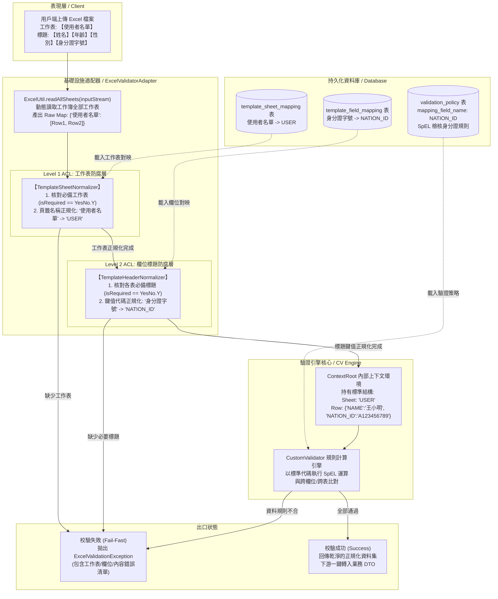
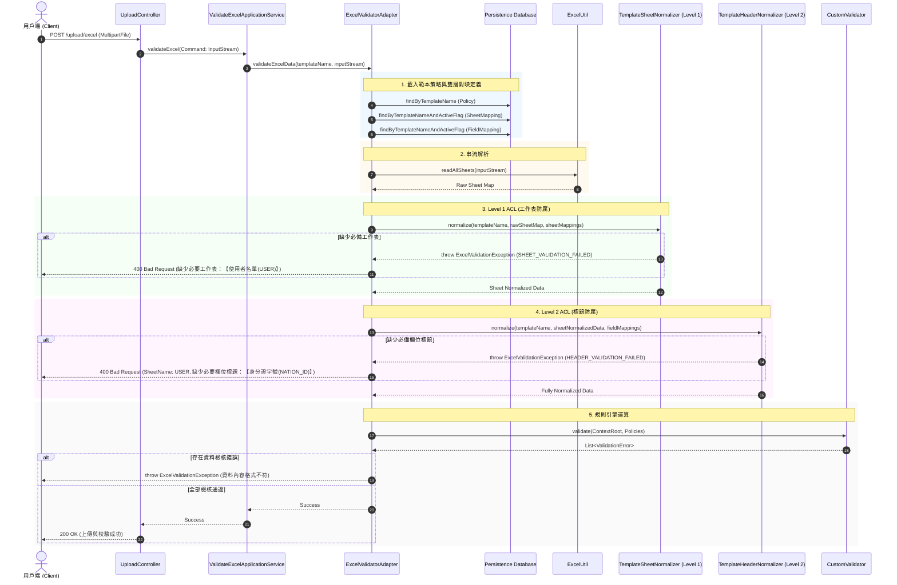
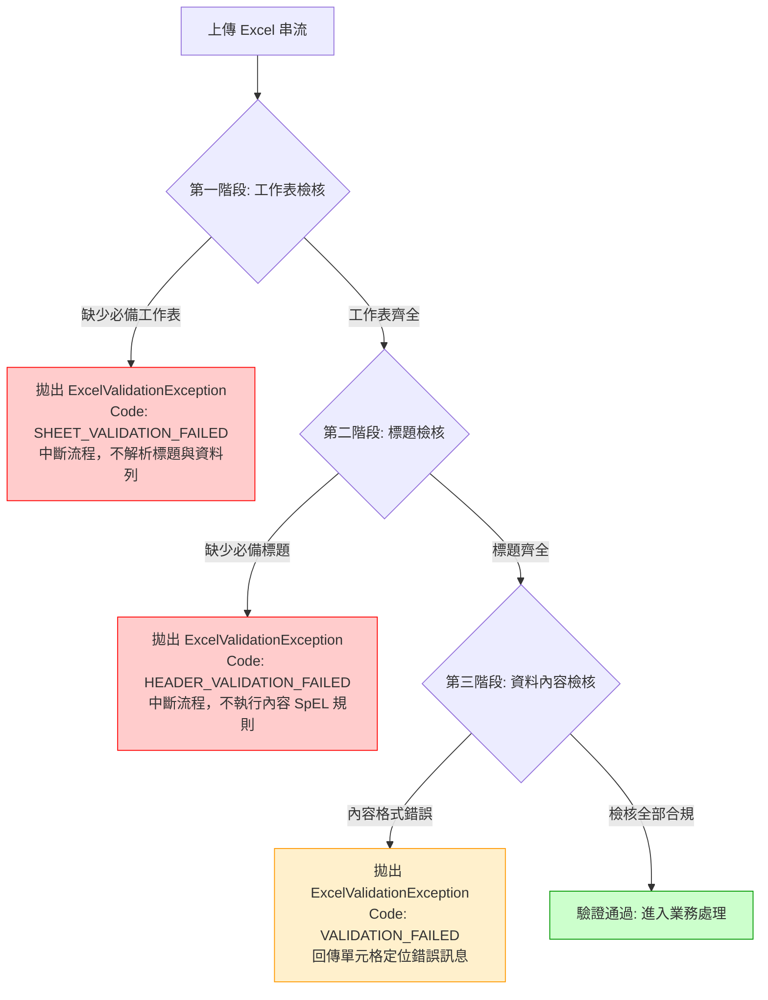

# Excel 範本雙層客製對映防腐機制規格說明書 (Two-Tier Template Mapping Specification)

> **文件版本**：v2.0.0 (正式發布版)  
> **更新日期**：2026-10-27  
> **狀態**：已落地實作 / 測試全數通過 (Implemented & Verified)  
> **架構規範遵循**：[AGENTS.md](file:///d:/桌面/ModuleWorkSpace/customized-validation-module/.agents/AGENTS.md) (Clean Architecture / 六角形架構 / DDD / Anti-Corruption Layer)

---

## 一、 背景與設計目標 (Background & Objectives)

### 1.1 現況痛點分析 (Pain Points)
在傳統 Excel 批次匯入與驗證架構中，檔案結構與檢核規則通常存在著高度的技術耦合與限制：
1. **工作表（Sheet）名稱技術代碼綁定**：
   - 過去解析 Excel 時，必須直接使用內部英文代碼作為頁籤名稱（例如 `USER`、`DEPT`、`MIS`、`HR`）。
   - 若使用者將工作表命名為直觀的中文名稱（如「使用者名單」、「部門清單」），系統無法辨識並直接略過或拋錯。
2. **欄位標題（Header）技術代碼綁定**：
   - Excel 首列標題必須完全相等於內部屬性大寫技術代碼（例如 `NAME`、`AGE`、`NATION_ID`）。
   - 終端業務人員或客戶無法填寫友善的繁體中文標題（如「姓名」、「年齡」、「身分證字號」），大幅降低系統通用性。
3. **缺乏結構層級前置防呆檢核 (Missing Fail-Fast Pre-check)**：
   - 若上傳檔案缺少必要工作表或必要標題，系統在未校驗的情況下直接讀入空資料或在運算過程中拋出非預期的 NullPointer 異常，無法在第一時間告知使用者「缺少必要工作表」或「缺少必要欄位標題」。
4. **內部 DTO 轉換阻抗 (Impedance Mismatch)**：
   - 驗證通過後欲使用 `ModelMapper` 轉換為 Java Bean / DTO 時，Map 的 Key（大寫蛇形）與 Java 屬性（CamelCase）無法自動對齊，需撰寫繁瑣的自訂轉換邏輯。

### 1.2 雙層防腐層 (Two-Tier ACL) 設計目標
為了解決上述痛點，本模組於基礎設施客製驗證核心（`infra.cv.normalizer`）中引入**雙層防腐層機制 (Two-Tier Anti-Corruption Layer)**：
- **Level 1：工作表層級防腐 (Sheet-Level ACL)**：
  - 由 [TemplateSheetNormalizer](file:///d:/桌面/ModuleWorkSpace/customized-validation-module/src/main/java/com/example/demo/infra/cv/normalizer/TemplateSheetNormalizer.java) 與 `template_sheet_mapping` 負責。
  - 將外部頁籤名稱（如「使用者名單」）正規化為內部統一工作表代碼（如 `USER`），並在前置階段校驗必要工作表是否存在。
- **Level 2：標題/欄位層級防腐 (Header/Field-Level ACL)**：
  - 由 [TemplateHeaderNormalizer](file:///d:/桌面/ModuleWorkSpace/customized-validation-module/src/main/java/com/example/demo/infra/cv/normalizer/TemplateHeaderNormalizer.java) 與 `template_field_mapping` 負責。
  - 將外部欄位標題（如「身分證字號」）正規化為內部屬性代碼（如 `NATION_ID` 或 `nationId`），並在前置階段校驗必要標題是否缺漏。
- **雙重別名相容機制 (Dual-Lookup Compatibility)**：
  - 字典同時註冊中文顯示名稱 (`displayName`) 與內部代碼 (`sheetCode` / `fieldCode`) 及其大小寫變體，使用者無論上傳中文版或英文技術代碼版 Excel 均能無縫支援。
- **零配置向下相容 (Zero-Configuration Fallback)**：
  - 若範本未配置對映定義，系統自動退回原始模式，相容既有舊版範本。
- **兩階段快速失敗 (Two-Phase Fail-Fast)**：
  - 先校驗工作表（缺少工作表立即中止），再校驗標題（缺少標題立即中止），最後才計算資料列內容，大幅節省無效運算開銷。

---

## 二、 系統架構與六角形架構對齊 (System Architecture & Hexagonal Alignment)

### 2.1 分層架構定位 (Hexagonal Architecture Alignment)

| 架構分層 | 具體套件路徑 (Package) | 代表元件與職責說明 |
| :--- | :--- | :--- |
| **基礎設施持久化實體**<br>*(Persistence Entity)* | `com.example.demo.infra.persistence.entity` | <ul><li>[TemplateSheetMapping](file:///d:/桌面/ModuleWorkSpace/customized-validation-module/src/main/java/com/example/demo/infra/persistence/entity/TemplateSheetMapping.java)：工作表對映持久化實體</li><li>[TemplateFieldMapping](file:///d:/桌面/ModuleWorkSpace/customized-validation-module/src/main/java/com/example/demo/infra/persistence/entity/TemplateFieldMapping.java)：欄位對映持久化實體</li><li>[ValidationPolicy](file:///d:/桌面/ModuleWorkSpace/customized-validation-module/src/main/java/com/example/demo/infra/persistence/entity/ValidationPolicy.java)：驗證規則策略實體</li></ul> |
| **基礎設施持久化倉儲**<br>*(Persistence Repository)* | `com.example.demo.infra.persistence.repository` | <ul><li>[TemplateSheetMappingRepository](file:///d:/桌面/ModuleWorkSpace/customized-validation-module/src/main/java/com/example/demo/infra/persistence/repository/TemplateSheetMappingRepository.java)：工作表對映 Spring Data JPA 倉儲</li><li>[TemplateFieldMappingRepository](file:///d:/桌面/ModuleWorkSpace/customized-validation-module/src/main/java/com/example/demo/infra/persistence/repository/TemplateFieldMappingRepository.java)：欄位對映 Spring Data JPA 倉儲</li></ul> |
| **客製驗證核心防腐層**<br>*(CV Normalizer Engine)* | `com.example.demo.infra.cv.normalizer` | <ul><li>[TemplateSheetNormalizer](file:///d:/桌面/ModuleWorkSpace/customized-validation-module/src/main/java/com/example/demo/infra/cv/normalizer/TemplateSheetNormalizer.java)：Level 1 工作表防呆校驗與名稱正規化器</li><li>[TemplateHeaderNormalizer](file:///d:/桌面/ModuleWorkSpace/customized-validation-module/src/main/java/com/example/demo/infra/cv/normalizer/TemplateHeaderNormalizer.java)：Level 2 標題防呆校驗與屬性鍵值正規化器</li></ul> |
| **基礎設施通用工具**<br>*(Infrastructure Util)* | `com.example.demo.infra.util` | <ul><li>[ExcelUtil](file:///d:/桌面/ModuleWorkSpace/customized-validation-module/src/main/java/com/example/demo/infra/util/ExcelUtil.java)：提供 `readAllSheets(InputStream)` 動態載入所有工作表</li></ul> |
| **基礎設施輸出適配器**<br>*(Outbound Adapter)* | `com.example.demo.infra.adapter` | <ul><li>[ExcelValidatorAdapter](file:///d:/桌面/ModuleWorkSpace/customized-validation-module/src/main/java/com/example/demo/infra/adapter/ExcelValidatorAdapter.java)：實作 `ExcelValidatorPort`，協調整合雙層防腐管道與驗證核心</li></ul> |
| **應用層例外與值物件**<br>*(Application Exception & VO)* | `com.example.demo.application` | <ul><li>[ExcelValidationException](file:///d:/桌面/ModuleWorkSpace/customized-validation-module/src/main/java/com/example/demo/application/exception/ExcelValidationException.java)：結構化驗證例外</li><li>[ValidationError](file:///d:/桌面/ModuleWorkSpace/customized-validation-module/src/main/java/com/example/demo/application/shared/vo/ValidationError.java)：Java 17 record 不可變錯誤快照</li></ul> |

---

### 2.2 雙層防腐架構端到端資料流 (End-to-End Architecture Data Flow)



---

### 2.3 執行時序圖 (Sequence Diagram)



---

## 三、 資料庫 Schema 與持久化實體設計 (Database Schema & Entity Design)

### 3.1 工作表對映表 `template_sheet_mapping`

#### DDL 規格
```sql
CREATE TABLE `template_sheet_mapping` (
  `id` bigint NOT NULL AUTO_INCREMENT COMMENT '主鍵識別碼',
  `template_name` varchar(64) CHARACTER SET utf8mb4 COLLATE utf8mb4_unicode_ci NOT NULL COMMENT '範本唯一名稱 (例如: USER_PROFILE, DEPT_PROFILE)',
  `sheet_code` varchar(64) CHARACTER SET utf8mb4 COLLATE utf8mb4_unicode_ci NOT NULL COMMENT '內部統一工作表代碼 (例如: USER, DEPT, MIS, HR)',
  `display_name` varchar(128) CHARACTER SET utf8mb4 COLLATE utf8mb4_unicode_ci NOT NULL COMMENT 'Excel 實體工作表頁籤顯示文字 (例如: 使用者名單, 部門清單)',
  `sheet_index` int DEFAULT NULL COMMENT '預期工作表索引 (0-based, 可選)',
  `is_required` char(1) CHARACTER SET utf8mb4 COLLATE utf8mb4_unicode_ci NOT NULL DEFAULT 'Y' COMMENT '是否為必備工作表 (Y/N)',
  `active_flag` char(1) CHARACTER SET utf8mb4 COLLATE utf8mb4_unicode_ci NOT NULL DEFAULT 'Y' COMMENT '啟用註記 (Y/N)',
  `created_time` datetime NOT NULL DEFAULT CURRENT_TIMESTAMP COMMENT '建立時間',
  `updated_time` datetime NOT NULL DEFAULT CURRENT_TIMESTAMP ON UPDATE CURRENT_TIMESTAMP COMMENT '更新時間',
  PRIMARY KEY (`id`),
  UNIQUE KEY `uq_template_sheet` (`template_name`, `sheet_code`),
  KEY `idx_sheet_template` (`template_name`),
  KEY `idx_sheet_display` (`template_name`, `display_name`)
) ENGINE=InnoDB DEFAULT CHARSET=utf8mb4 COLLATE=utf8mb4_unicode_ci COMMENT='Excel 範本工作表客製對映定義表';
```

#### JPA 實體：[TemplateSheetMapping.java](file:///d:/桌面/ModuleWorkSpace/customized-validation-module/src/main/java/com/example/demo/infra/persistence/entity/TemplateSheetMapping.java)
```java
@Entity
@Getter
@Setter
@ToString
@NoArgsConstructor
@AllArgsConstructor
@Table(name = "template_sheet_mapping")
public class TemplateSheetMapping implements Serializable {
    private static final long serialVersionUID = 1L;

    @Id
    @GeneratedValue(strategy = GenerationType.IDENTITY)
    private Long id;

    @Column(name = "template_name", nullable = false, length = 64)
    private String templateName;

    @Column(name = "sheet_code", nullable = false, length = 64)
    private String sheetCode;

    @Column(name = "display_name", nullable = false, length = 128)
    private String displayName;

    @Column(name = "sheet_index")
    private Integer sheetIndex;

    @Enumerated(EnumType.STRING)
    @Column(name = "is_required", nullable = false, length = 1)
    private YesNo isRequired = YesNo.Y;

    @Enumerated(EnumType.STRING)
    @Column(name = "active_flag", nullable = false, length = 1)
    private YesNo activeFlag = YesNo.Y;

    @Column(name = "created_time", nullable = false, updatable = false)
    private LocalDateTime createdTime = LocalDateTime.now();

    @Column(name = "updated_time", nullable = false)
    private LocalDateTime updatedTime = LocalDateTime.now();
}
```

---

### 3.2 欄位對映表 `template_field_mapping`

#### DDL 規格
```sql
CREATE TABLE `template_field_mapping` (
  `id` bigint NOT NULL AUTO_INCREMENT COMMENT '主鍵識別碼',
  `template_name` varchar(64) CHARACTER SET utf8mb4 COLLATE utf8mb4_unicode_ci NOT NULL COMMENT '範本唯一名稱 (例如: USER_PROFILE, DEPT_PROFILE)',
  `template_sheet_name` varchar(64) CHARACTER SET utf8mb4 COLLATE utf8mb4_unicode_ci NOT NULL COMMENT '工作表代碼 (例如: USER, DEPT, MIS, HR)',
  `field_code` varchar(64) CHARACTER SET utf8mb4 COLLATE utf8mb4_unicode_ci NOT NULL COMMENT '內部統一屬性代碼 (例如: NAME, AGE, SEX, NATION_ID)',
  `display_name` varchar(128) CHARACTER SET utf8mb4 COLLATE utf8mb4_unicode_ci NOT NULL COMMENT 'Excel 實體標題文字 (例如: 姓名, 年齡, 性別, 身分證字號)',
  `column_index` int DEFAULT NULL COMMENT '實體欄位預期順序 (1-based, 可選)',
  `is_required` char(1) CHARACTER SET utf8mb4 COLLATE utf8mb4_unicode_ci NOT NULL DEFAULT 'N' COMMENT '是否為必填/必備欄位 (Y/N)',
  `data_type` varchar(32) CHARACTER SET utf8mb4 COLLATE utf8mb4_unicode_ci NOT NULL DEFAULT 'STRING' COMMENT '資料型別 (STRING, NUMBER, DATE...)',
  `active_flag` char(1) CHARACTER SET utf8mb4 COLLATE utf8mb4_unicode_ci NOT NULL DEFAULT 'Y' COMMENT '啟用註記 (Y/N)',
  `created_time` datetime NOT NULL DEFAULT CURRENT_TIMESTAMP COMMENT '建立時間',
  `updated_time` datetime NOT NULL DEFAULT CURRENT_TIMESTAMP ON UPDATE CURRENT_TIMESTAMP COMMENT '更新時間',
  PRIMARY KEY (`id`),
  UNIQUE KEY `uq_template_sheet_field` (`template_name`, `template_sheet_name`, `field_code`),
  KEY `idx_template_sheet` (`template_name`, `template_sheet_name`),
  KEY `idx_template_sheet_display` (`template_name`, `template_sheet_name`, `display_name`)
) ENGINE=InnoDB DEFAULT CHARSET=utf8mb4 COLLATE=utf8mb4_unicode_ci COMMENT='Excel 範本欄位客製對映定義表';
```

#### JPA 實體：[TemplateFieldMapping.java](file:///d:/桌面/ModuleWorkSpace/customized-validation-module/src/main/java/com/example/demo/infra/persistence/entity/TemplateFieldMapping.java)
```java
@Entity
@Getter
@Setter
@ToString
@NoArgsConstructor
@AllArgsConstructor
@Table(name = "template_field_mapping")
public class TemplateFieldMapping implements Serializable {
    private static final long serialVersionUID = 1L;

    @Id
    @GeneratedValue(strategy = GenerationType.IDENTITY)
    private Long id;

    @Column(name = "template_name", nullable = false, length = 64)
    private String templateName;

    @Column(name = "template_sheet_name", nullable = false, length = 64)
    private String templateSheetName;

    @Column(name = "field_code", nullable = false, length = 64)
    private String fieldCode;

    @Column(name = "display_name", nullable = false, length = 128)
    private String displayName;

    @Column(name = "column_index")
    private Integer columnIndex;

    @Enumerated(EnumType.STRING)
    @Column(name = "is_required", nullable = false, length = 1)
    private YesNo isRequired = YesNo.N;

    @Column(name = "data_type", nullable = false, length = 32)
    private String dataType = "STRING";

    @Enumerated(EnumType.STRING)
    @Column(name = "active_flag", nullable = false, length = 1)
    private YesNo activeFlag = YesNo.Y;

    @Column(name = "created_time", nullable = false, updatable = false)
    private LocalDateTime createdTime = LocalDateTime.now();

    @Column(name = "updated_time", nullable = false)
    private LocalDateTime updatedTime = LocalDateTime.now();
}
```

---

## 四、 核心處理機制與防腐演算法 (Core Mechanisms & Algorithms)

### 4.1 第一層防腐：工作表名稱正規化 (`TemplateSheetNormalizer`)
元件檔案：[TemplateSheetNormalizer.java](file:///d:/桌面/ModuleWorkSpace/customized-validation-module/src/main/java/com/example/demo/infra/cv/normalizer/TemplateSheetNormalizer.java)

#### 運作演算法
1. **雙向別名字典建置 (Dual-Alias Dictionary Building)**：
   - 走訪 `List<TemplateSheetMapping>`，為每個工作表註冊以下鍵值映射：
     - `displayName.trim()` $\rightarrow$ `sheetCode` (如 `"使用者名單"` $\rightarrow$ `"USER"`)
     - `sheetCode` $\rightarrow$ `sheetCode` (如 `"USER"` $\rightarrow$ `"USER"`)
     - `sheetCode.toUpperCase()` 及 `sheetCode.toLowerCase()`
   - **效果**：無論上傳檔案之頁籤為「使用者名單」或直接為技術名稱「USER」，均能正確識別為標準代碼 `USER`。
2. **工作表前置防呆校驗 (`validateRequiredSheets`)**：
   - 篩選所有 `isRequired == YesNo.Y` 的工作表對映定義。
   - 檢查用戶端上傳之工作表名稱集合（經首尾去除空白後），是否包含該工作表之 `displayName` 或 `sheetCode`。
   - 若缺失，立即建立 [ValidationError](file:///d:/桌面/ModuleWorkSpace/customized-validation-module/src/main/java/com/example/demo/application/shared/vo/ValidationError.java)：
     ```text
     "範本 [USER_PROFILE] 缺少必要工作表：【使用者名單(USER)】"
     ```
   - 若有任何必備工作表缺失，立即拋出 [ExcelValidationException](file:///d:/桌面/ModuleWorkSpace/customized-validation-module/src/main/java/com/example/demo/application/exception/ExcelValidationException.java)（ErrorCode: `SHEET_VALIDATION_FAILED`），中斷後續運算。
3. **工作表名稱代碼轉換 (Normalization)**：
   - 將上傳之 `Map<ActualSheetName, List<RowMap>>` 的 Key 統一替換為對應的標準 `sheetCode`。
   - 產出結構：`Map<NormalizedSheetCode, List<RowMap>>`。

---

### 4.2 第二層防腐：標題與鍵值正規化 (`TemplateHeaderNormalizer`)
元件檔案：[TemplateHeaderNormalizer.java](file:///d:/桌面/ModuleWorkSpace/customized-validation-module/src/main/java/com/example/demo/infra/cv/normalizer/TemplateHeaderNormalizer.java)

#### 運作演算法
1. **依工作表代碼分群對映定義**：
   - 將 `List<TemplateFieldMapping>` 依據 `templateSheetName` 進行分群，精準鎖定各工作表專屬的欄位定義。
2. **工作表標題前置防呆校驗 (`validateRequiredHeaders`)**：
   - 針對有資料列的工作表，以第 0 列所有 Key 作為上傳的標題集合（`uploadedHeaders`）。
   - 走訪該表所有 `isRequired == YesNo.Y` 之欄位定義。
   - 檢查 `uploadedHeaders` 中是否包含 `displayName` 或 `fieldCode`。
   - 若缺失，立即建立 [ValidationError](file:///d:/桌面/ModuleWorkSpace/customized-validation-module/src/main/java/com/example/demo/application/shared/vo/ValidationError.java)：
     ```text
     "SheetName : USER, 缺少必要欄位標題：【身分證字號(NATION_ID)】"
     ```
3. **逐列鍵值替換 (Row Key Normalization)**：
   - 對於每一筆資料列 `Map<RawHeader, CellValue>`，逐一比對標題字典。
   - 若符合 `displayName` 或 `fieldCode`，轉換為系統內部統一代碼（`fieldCode`）；未設定對映之欄位則保留原始標題作為 Fallback。
4. **錯誤集結與阻斷 (Header Fail-Fast)**：
   - 遍歷所有工作表後，若收集到任何必要欄位缺失錯誤，拋出 [ExcelValidationException](file:///d:/桌面/ModuleWorkSpace/customized-validation-module/src/main/java/com/example/demo/application/exception/ExcelValidationException.java)（ErrorCode: `HEADER_VALIDATION_FAILED`）。

---

### 4.3 兩階段快速失敗 (Two-Phase Fail-Fast) 例外體系



---

## 五、 適配器整合與驗證管線 (`ExcelValidatorAdapter`)

元件檔案：[ExcelValidatorAdapter.java](file:///d:/桌面/ModuleWorkSpace/customized-validation-module/src/main/java/com/example/demo/infra/adapter/ExcelValidatorAdapter.java)

### 5.1 完整驗證處理管線 (Pipeline 7 步驟)

```java
@Override
public void validateExcelData(String templateName, InputStream inputStream) {
    // 步驟 1: 自資料庫取出該範本設定的所有驗證規則、工作表對映與欄位對映設定
    List<ValidationPolicy> policyList = validationPolicyRepository.findByTemplateName(templateName);
    List<TemplateSheetMapping> sheetMappings = templateSheetMappingRepository
            .findByTemplateNameAndActiveFlag(templateName, YesNo.Y);
    List<TemplateFieldMapping> fieldMappings = templateFieldMappingRepository
            .findByTemplateNameAndActiveFlag(templateName, YesNo.Y);

    // 步驟 2: 讀取 Excel 試算表串流之工作表資料集 (若配置 Sheet 對映則動態讀取全部工作表)
    Map<String, List<Map<String, String>>> rawExcelData = sheetMappings.isEmpty()
            ? ExcelUtil.readExcelData(inputStream, extractPolicySheets(policyList))
            : ExcelUtil.readAllSheets(inputStream);

    // 步驟 3: 第一層防腐 (Level 1 ACL) - 工作表防呆與頁籤代碼正規化
    Map<String, List<Map<String, String>>> sheetNormalizedData = templateSheetNormalizer
            .normalize(templateName, rawExcelData, sheetMappings);

    // 步驟 4: 第二層防腐 (Level 2 ACL) - 標題防呆與欄位屬性代碼正規化
    Map<String, List<Map<String, String>>> normalizedExcelData = templateHeaderNormalizer
            .normalize(templateName, sheetNormalizedData, fieldMappings);

    // 步驟 5: 封裝檢核上下文根物件 (ContextRoot)，提供 SpEL 執行環境所需參數與工作表友善名稱對映字典
    Map<String, String> sheetDisplayNameMap = new LinkedHashMap<>();
    if (sheetMappings != null) {
        for (TemplateSheetMapping mapping : sheetMappings) {
            sheetDisplayNameMap.put(mapping.getSheetCode(), mapping.getDisplayName());
        }
    }

    ContextRoot contextRoot = ContextRoot.builder()
            .params(new LinkedHashMap<>())
            .sheetMap(normalizedExcelData)
            .sheetDisplayNameMap(sheetDisplayNameMap)
            .build();

    // 步驟 6: 呼叫驗證核心評估各項規則 (SpEL 計算時原生代入友善工作表顯示名稱)
    List<ValidationError> validationErrors = customValidator.validateExcelData(contextRoot, policyList);

    // 步驟 7: 若存在錯誤項目，立即拋出結構化檢核例外阻斷後續流程
    if (!validationErrors.isEmpty()) {
        throw new ExcelValidationException("EXCEL_DATA_VALIDATION_FAILED", validationErrors);
    }
}
```

> **📌 錯誤訊息工作表名稱友善轉譯決策 (Context-level SheetName Binding)**：  
> 當驗證核心 [CustomValidator](file:///d:/桌面/ModuleWorkSpace/customized-validation-module/src/main/java/com/example/demo/infra/cv/validator/CustomValidator.java) 在評估 SpEL 錯誤訊息範本（例如 `'SheetName : ' + #sheetName + ...'`）時，直接從 [ContextRoot](file:///d:/桌面/ModuleWorkSpace/customized-validation-module/src/main/java/com/example/demo/infra/cv/shared/context/ContextRoot.java) 中取用 `sheetDisplayNameMap` 將 `#sheetName` 綁定為外部友善顯示名稱（如「使用者名單」），保證 SpEL 原生渲染出友善錯誤訊息，避免於出口端進行脆弱的字串模糊替換。


---

## 六、 測試策略與驗證情境 (Testing Strategy & Verification)

本模組依照 [AGENTS.md](file:///d:/桌面/ModuleWorkSpace/customized-validation-module/.agents/AGENTS.md) 規範，全數採用 **Gherkin BDD 語法（Feature, Scenario, Given-When-Then）** 撰寫測試規格與 Javadoc。

### 6.1 測試套件與案例覆蓋矩陣

| 測試類別 | 測試案例方法 | Gherkin 驗證情境 | 預期結果 |
| :--- | :--- | :--- | :--- |
| **[TemplateSheetNormalizerTest](file:///d:/桌面/ModuleWorkSpace/customized-validation-module/src/test/java/com/example/demo/infra/cv/normalizer/TemplateSheetNormalizerTest.java)** | `testNormalize_withChineseDisplayNames_success` | **Scenario**: 上傳實體中文工作表名稱<br>**Given**: 範本設定 `使用者名單` $\rightarrow$ `USER`<br>**When**: 上傳含「使用者名單」之工作簿<br>**Then**: 工作表 Key 成功正規化為 `USER` | 驗證通過，回傳轉換後資料 |
| | `testNormalize_withTechnicalSheetCodes_success` | **Scenario**: 上傳直接以技術代碼命名之工作表<br>**Given**: 包含 `USER` 頁籤<br>**When**: 執行正規化<br>**Then**: 雙向對照成功辨識並維持 `USER` | 驗證通過，向下相容 |
| | `testNormalize_missingRequiredSheet_throwsException` | **Scenario**: 缺少必備工作表時快速失敗<br>**Given**: `USER` 標記為必備，上傳檔案缺漏該頁籤<br>**When**: 執行工作表校驗<br>**Then**: 拋出 `ExcelValidationException`，錯誤碼為 `SHEET_VALIDATION_FAILED` | 阻斷流程，包含友善中文錯誤提示 |
| | `testNormalize_noMappingsConfigured_fallbackOriginal` | **Scenario**: 未設定對映時向下相容<br>**Given**: `sheetMappings` 為空清單<br>**When**: 執行正規化<br>**Then**: 原樣回傳上傳之原始工作表名稱 | 零破壞相容性 |
| **[TemplateHeaderNormalizerTest](file:///d:/桌面/ModuleWorkSpace/customized-validation-module/src/test/java/com/example/demo/infra/cv/normalizer/TemplateHeaderNormalizerTest.java)** | `testNormalize_withChineseHeaders_success` | **Scenario**: 上傳實體中文標題<br>**Given**: 設定 `身分證字號` $\rightarrow$ `NATION_ID`<br>**When**: 上傳含中文標題之列資料<br>**Then**: 資料列 Map 鍵值正規化為 `NATION_ID` | 驗證通過，鍵值替換成功 |
| | `testNormalize_withTechnicalHeaders_success` | **Scenario**: 上傳技術代碼標題<br>**Given**: 上傳含 `NATION_ID` 或 `nation_id` 標題<br>**When**: 執行標題正規化<br>**Then**: 成功識別並標準化為內部代碼 | 驗證通過，英文代碼相容 |
| | `testNormalize_missingRequiredHeaders_throwsException` | **Scenario**: 缺少必要欄位標題阻斷<br>**Given**: `NATION_ID` 為必備，上傳標題未包含<br>**When**: 執行標題防呆校驗<br>**Then**: 拋出 `ExcelValidationException`，錯誤碼為 `HEADER_VALIDATION_FAILED` | 阻斷流程，提示缺少身分證字號 |
| | `testNormalize_emptyMappings_fallbackOriginal` | **Scenario**: 未配置欄位對映時維持原始 Map | 原樣回傳，相容舊版 |
| **[ExcelValidatorAdapterTest](file:///d:/桌面/ModuleWorkSpace/customized-validation-module/src/test/java/com/example/demo/infra/adapter/ExcelValidatorAdapterTest.java)** | `validateExcelData_shouldPass_whenDataIsValid` | **Scenario**: 完整驗證管線端到端成功整合測試 | 流程全數執行完成，無例外 |

### 6.2 測試執行成果
執行命令：
```powershell
.\mvnw.cmd clean test
```
驗收輸出：
```text
[INFO] Running com.example.demo.infra.cv.normalizer.TemplateSheetNormalizerTest
[INFO] Tests run: 4, Failures: 0, Errors: 0, Skipped: 0
[INFO] Running com.example.demo.infra.cv.normalizer.TemplateHeaderNormalizerTest
[INFO] Tests run: 4, Failures: 0, Errors: 0, Skipped: 0
[INFO] Running com.example.demo.infra.adapter.ExcelValidatorAdapterTest
[INFO] Tests run: 1, Failures: 0, Errors: 0, Skipped: 0
[INFO] -------------------------------------------------------
[INFO] BUILD SUCCESS
[INFO] -------------------------------------------------------
```

---

## 七、 實務設定範例與上傳格式對照 (Practical Use Cases)

### 7.1 `USER_PROFILE` 人員基本資料範本實務對照

#### 工作表設定 (`template_sheet_mapping`)
| 範本名稱 | 實體頁籤名稱 (`display_name`) | 內部工作表代碼 (`sheet_code`) | 順序 | 必備 |
| :--- | :--- | :--- | :---: | :---: |
| `USER_PROFILE` | **使用者名單** | `USER` | 0 | **Y** |
| `USER_PROFILE` | **所屬部門** | `DEPT` | 1 | **Y** |

#### 欄位標題設定 (`template_field_mapping`)
| 內部工作表代碼 | 實體標題名稱 (`display_name`) | 內部屬性代碼 (`field_code`) | 順序 | 必備 | 型別 |
| :--- | :--- | :--- | :---: | :---: | :---: |
| `USER` | **姓名** | `NAME` | 1 | **Y** | STRING |
| `USER` | **年齡** | `AGE` | 2 | **Y** | NUMBER |
| `USER` | **性別** | `SEX` | 3 | **Y** | STRING |
| `USER` | **身分證字號** | `NATION_ID` | 4 | **Y** | STRING |
| `DEPT` | **姓名** | `NAME` | 1 | N | STRING |
| `DEPT` | **員工編號** | `EMP_NO` | 2 | N | STRING |
| `DEPT` | **職稱** | `JOB_TITLE` | 3 | N | STRING |
| `DEPT` | **部門** | `DEPT` | 4 | **Y** | STRING |

#### Excel 上傳實體外觀
- **頁籤 1:「使用者名單」**
  | 姓名 | 年齡 | 性別 | 身分證字號 |
  | :--- | :--- | :--- | :--- |
  | 王小明 | 28 | 男 | A123456789 |
  | 李小花 | 32 | 女 | B234567890 |
- **頁籤 2:「所屬部門」**
  | 姓名 | 員工編號 | 職稱 | 部門 |
  | :--- | :--- | :--- | :--- |
  | 王小明 | EMP001 | 專案經理 | 資訊部 |
  | 李小花 | EMP002 | 資深工程師 | 人力資源部 |

---

## 八、 檔案變更矩陣 (File Matrix)

| 檔案路徑 | 分層 (Layer) | 職責與用途說明 |
| :--- | :--- | :--- |
| [TemplateSheetMapping.java](file:///d:/桌面/ModuleWorkSpace/customized-validation-module/src/main/java/com/example/demo/infra/persistence/entity/TemplateSheetMapping.java) | `infra.persistence.entity` | 映射 `template_sheet_mapping` 表，定義工作表對映契約 |
| [TemplateSheetMappingRepository.java](file:///d:/桌面/ModuleWorkSpace/customized-validation-module/src/main/java/com/example/demo/infra/persistence/repository/TemplateSheetMappingRepository.java) | `infra.persistence.repository` | 工作表對映 Spring Data JPA 倉儲 |
| [TemplateSheetNormalizer.java](file:///d:/桌面/ModuleWorkSpace/customized-validation-module/src/main/java/com/example/demo/infra/cv/normalizer/TemplateSheetNormalizer.java) | `infra.cv.normalizer` | Level 1 ACL 工作表防腐器，執行工作表前置防呆與名稱正規化 |
| [TemplateFieldMapping.java](file:///d:/桌面/ModuleWorkSpace/customized-validation-module/src/main/java/com/example/demo/infra/persistence/entity/TemplateFieldMapping.java) | `infra.persistence.entity` | 映射 `template_field_mapping` 表，定義欄位標題對映契約 |
| [TemplateFieldMappingRepository.java](file:///d:/桌面/ModuleWorkSpace/customized-validation-module/src/main/java/com/example/demo/infra/persistence/repository/TemplateFieldMappingRepository.java) | `infra.persistence.repository` | 欄位標題對映 Spring Data JPA 倉儲 |
| [TemplateHeaderNormalizer.java](file:///d:/桌面/ModuleWorkSpace/customized-validation-module/src/main/java/com/example/demo/infra/cv/normalizer/TemplateHeaderNormalizer.java) | `infra.cv.normalizer` | Level 2 ACL 標題防腐器，執行標題前置防呆與鍵值正規化 |
| [ExcelUtil.java](file:///d:/桌面/ModuleWorkSpace/customized-validation-module/src/main/java/com/example/demo/infra/util/ExcelUtil.java) | `infra.util` | 提供 `readAllSheets(InputStream)` 動態解析工作簿多工作表 |
| [ExcelValidatorAdapter.java](file:///d:/桌面/ModuleWorkSpace/customized-validation-module/src/main/java/com/example/demo/infra/adapter/ExcelValidatorAdapter.java) | `infra.adapter` | 串接 Level 1 與 Level 2 防腐層並驅動客製驗證核心 |
| [TemplateSheetMappingController.java](file:///d:/桌面/ModuleWorkSpace/customized-validation-module/src/main/java/com/example/demo/iface/rest/TemplateSheetMappingController.java) | `iface.rest` | 工作表對映 REST 控制器 (支援 OpenAPI 3.0 CRUD 端點) |
| [TemplateFieldMappingController.java](file:///d:/桌面/ModuleWorkSpace/customized-validation-module/src/main/java/com/example/demo/iface/rest/TemplateFieldMappingController.java) | `iface.rest` | 欄位對映 REST 控制器 (支援 OpenAPI 3.0 CRUD 端點) |
| [UploadController.java](file:///d:/桌面/ModuleWorkSpace/customized-validation-module/src/main/java/com/example/demo/iface/rest/UploadController.java) | `iface.rest` | 範本檔案上傳控制器 (含 PR_IMPORT Swagger 預設範例與 HTTP 422 檢核回應) |
| [OpenApiConfig.java](file:///d:/桌面/ModuleWorkSpace/customized-validation-module/src/main/java/com/example/demo/config/OpenApiConfig.java) | `config` | SpringDoc OpenAPI 3.0 全域中繼規格配置 |
| [WebConfig.java](file:///d:/桌面/ModuleWorkSpace/customized-validation-module/src/main/java/com/example/demo/config/WebConfig.java) | `config` | 表現層 Web 轉換器配置，相容 Swagger UI Multipart 傳輸 |
| [init-schema.sql](file:///d:/桌面/ModuleWorkSpace/customized-validation-module/init-schema.sql) | 根目錄 | 包含 `template_sheet_mapping` 與 `template_field_mapping` 之 DDL 與測試資料 |
| [pr-import-init.sql](file:///d:/桌面/ModuleWorkSpace/customized-validation-module/pr-import-init.sql) | 根目錄 | PR 請購單匯入範本專屬 DDL 與對映/檢核策略設定腳本 |
| [TemplateSheetNormalizerTest.java](file:///d:/桌面/ModuleWorkSpace/customized-validation-module/src/test/java/com/example/demo/infra/cv/normalizer/TemplateSheetNormalizerTest.java) | `src/test/java` | 工作表防腐層單元測試 (含完整 Gherkin BDD 規格說明) |
| [TemplateHeaderNormalizerTest.java](file:///d:/桌面/ModuleWorkSpace/customized-validation-module/src/test/java/com/example/demo/infra/cv/normalizer/TemplateHeaderNormalizerTest.java) | `src/test/java` | 標題防腐層單元測試 (含完整 Gherkin BDD 規格說明) |
| [PrImportValidateTest.java](file:///d:/桌面/ModuleWorkSpace/customized-validation-module/src/test/java/com/example/demo/service/PrImportValidateTest.java) | `src/test/java` | PR Import 端到端情境檢核測試套件 |

---

## 九、 OpenAPI 3.0 與表現層 Swagger 註解規格 (OpenAPI & Swagger Annotations)

本模組已全面導入 SpringDoc OpenAPI 3.0 (`springdoc-openapi-starter-webmvc-ui:2.8.5`)，為表現層控制器與所有請求/回應資源（Resources）提供結構化 API 文件與線上互動測試能力。

### 9.1 線上文件端點
- **Swagger UI 介面**：`http://localhost:8080/swagger-ui/index.html`
- **OpenAPI 3.0 JSON 規格**：`http://localhost:8080/v3/api-docs`

### 9.2 控制器分群與標註架構
各 REST 控制器均依循 [AGENTS.md](file:///d:/桌面/ModuleWorkSpace/customized-validation-module/.agents/AGENTS.md) 輸入適配器規範，標註清晰的 `@Tag`、`@Operation`、`@Parameter` 與 `@ApiResponses`：

1. **範本上傳檢核 API ([UploadController](file:///d:/桌面/ModuleWorkSpace/customized-validation-module/src/main/java/com/example/demo/iface/rest/UploadController.java))**：
   - 包含 `@Operation(summary = "上傳並校驗 Excel 範本檔案")`。
   - `resource` 參數透過 `@ExampleObject` 預設綁定 `PR_IMPORT` 完整 JSON 範例。
   - 清楚定義 `@ApiResponse`：`200 OK` (成功)、`400 BAD_REQUEST` (參數不合規) 與 `422 UNPROCESSABLE_ENTITY` (Excel 業務檢核失敗)。
2. **範本工作表對映管理 API ([TemplateSheetMappingController](file:///d:/桌面/ModuleWorkSpace/customized-validation-module/src/main/java/com/example/demo/iface/rest/TemplateSheetMappingController.java))**：
   - 提供工作表對映之建立 (`POST`)、更新 (`PUT`)、單筆查詢 (`GET /{id}`)、清單查詢 (`GET`) 與刪除 (`DELETE /{id}`) 等完整生命週期端點。
3. **範本欄位對映管理 API ([TemplateFieldMappingController](file:///d:/桌面/ModuleWorkSpace/customized-validation-module/src/main/java/com/example/demo/iface/rest/TemplateFieldMappingController.java))**：
   - 提供欄位標題對映之建立 (`POST`)、更新 (`PUT`)、單筆查詢 (`GET /{id}`)、清單查詢 (`GET`) 與刪除 (`DELETE /{id}`) 等完整生命週期端點。

### 9.3 表現層資源純資料載體 (`resource/`) 之 `@Schema` 註解規範
所有請求資源（`in/`）與回應資源（`out/`）均已加上 `@Schema` 類別說明與屬性範例：

* **請求載體 (Inbound)**：
  - [UploadTemplateResource](file:///d:/桌面/ModuleWorkSpace/customized-validation-module/src/main/java/com/example/demo/iface/resource/in/UploadTemplateResource.java)：包含完整的 `PR_IMPORT` 預設值與各欄位用途說明。
  - [CreateTemplateSheetMappingResource](file:///d:/桌面/ModuleWorkSpace/customized-validation-module/src/main/java/com/example/demo/iface/resource/in/CreateTemplateSheetMappingResource.java) / [UpdateTemplateSheetMappingResource](file:///d:/桌面/ModuleWorkSpace/customized-validation-module/src/main/java/com/example/demo/iface/resource/in/UpdateTemplateSheetMappingResource.java)
  - [CreateTemplateFieldMappingResource](file:///d:/桌面/ModuleWorkSpace/customized-validation-module/src/main/java/com/example/demo/iface/resource/in/CreateTemplateFieldMappingResource.java) / [UpdateTemplateFieldMappingResource](file:///d:/桌面/ModuleWorkSpace/customized-validation-module/src/main/java/com/example/demo/iface/resource/in/UpdateTemplateFieldMappingResource.java)
* **回應載體 (Outbound)**：
  - [BaseExceptionsResponse](file:///d:/桌面/ModuleWorkSpace/customized-validation-module/src/main/java/com/example/demo/iface/resource/out/BaseExceptionsResponse.java)：標註 `code` (`VALIDATE_FAILED`) 與批次檢核錯誤清單格式。
  - [BaseExceptionResponse](file:///d:/桌面/ModuleWorkSpace/customized-validation-module/src/main/java/com/example/demo/iface/resource/out/BaseExceptionResponse.java)：標註單筆例外代碼與提示文字。
  - [TemplateUploadedResource](file:///d:/桌面/ModuleWorkSpace/customized-validation-module/src/main/java/com/example/demo/iface/resource/out/TemplateUploadedResource.java)：標註 `200` 與 `上傳成功` 結構。
  - [TemplateSheetMappingCreatedResource](file:///d:/桌面/ModuleWorkSpace/customized-validation-module/src/main/java/com/example/demo/iface/resource/out/TemplateSheetMappingCreatedResource.java) 等 10 個 CRUD 回應資源，均帶有時間戳記與識別碼範例。
